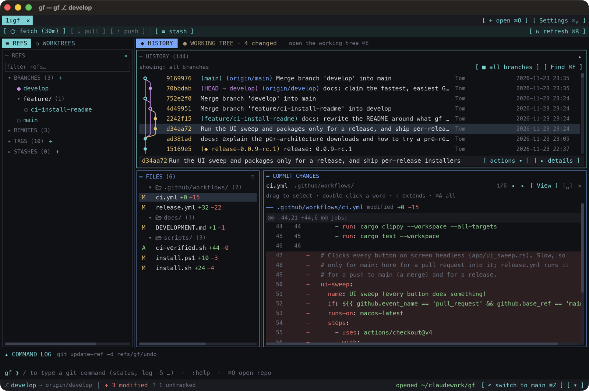

<p align="center">
  
</p>

<h1 align="center">gf</h1>

<p align="center">
  <b>Git Fast.</b> A Git GUI for macOS and Windows, written in Rust.
</p>

<p align="center">
  <a href="https://github.com/tom-kwak/GitFast/releases/latest"></a>
  
  
  
</p>

<p align="center">
  
</p>

## Install

macOS (Terminal) · Windows (Git Bash):

```bash
curl -fsSL https://github.com/tom-kwak/GitFast/releases/latest/download/install.sh | bash
```

Windows (PowerShell):

```powershell
irm https://github.com/tom-kwak/GitFast/releases/latest/download/install.ps1 | iex
```

macOS 11+ (Apple silicon, Intel) · Windows 10+ x64 · Git 2.43.1+. Run again to update.

## What it does

gf looks like a terminal (one monospace font, text-drawn graph, `[ OK ]`
buttons) and works with the mouse or the keyboard alike. Every git command it
runs is shown, and anything it does not cover can be typed on its `gf ❯` line.

### Everyday work

- **History**: a commit graph drawn in text, with branch and tag labels.
  Lines to parents more than 50 rows below are cut into arrows (`↓`, `↑N`),
  so the graph stays narrow. `⌘F` lists only the commits that changed a file.
- **Working tree**: stage files, hunks or single lines; stage, stash or
  discard several files at once. `⌘↩` commits, and the commit box can amend
  the last commit.
- **Diffs** with syntax highlighting, and **blame** for any file.
- **Branches, tags and stashes** in the refs panel (`⌘B`), each with its own
  menu: checkout, "compare with current" (`c`), "new worktree…" (`w`),
  delete. Tags are listed newest version first.
- **Fetch, pull and push** from the toolbar. A pull that only fast-forwards
  runs at once; one that must merge or rebase asks first. Push asks before it
  would force or be rejected.

### History rewriting and fixes

- From a commit's menu: cherry-pick, revert, reset the branch to it, squash
  it into the previous one, check it out without a branch, start
  **interactive rebase** (reorder, squash, reword, drop) or **bisect**.
- **Merge, rebase and cherry-pick conflicts** open a resolver: take ours,
  theirs or both, block by block. A banner shows the operation in progress
  with continue, skip and abort.
- **Submodules** and **Git LFS** (track, untrack, pull) from the refs panel.

### Safe by default

- Deleting anything asks first and takes a click (Enter does not confirm).
  Changes to the working tree or `HEAD` say what will change and whether it
  can be undone.
- **Undo** (`⌘Z` / `⌘⇧Z`) covers commits, resets, checkouts, pulls,
  discarded changes and more; see [Undo](#undo).
- The **command log** (`⌘J`) lists every git command gf ran, with its
  output, exit status and duration.

### Several repositories and trees

- **Tabs**: one per repository or worktree, restored at start. Drag a tab to
  reorder it; `⌘1`–`⌘9`, `⌃⇥` and `⌘P` switch between them.
- **Worktrees panel** (`⌘⇧B`) for several working trees at once, for example
  one per AI agent; see [Worktrees](#worktrees).

### Remotes and logins

- **Clone by URL**: `⌘O` accepts a URL and clones it in the background; Esc
  cancels.
- **Logins**: Settings keeps your HTTPS git logins in git's own credential
  helper, shared with terminal git. A fetch, pull or push that fails on
  authentication asks for a login and retries.

### Look

- Themes `gf-dark`, `gf-light`, `dracula`, `cd-dark` and `cd-light`, and
  the font size, in Settings (`⌘,`).

## Speed: `git` CLI vs. gf

To show a repository, gf reads its status, changed lines, history, branches
and stashes. The `git` CLI starts a new process for each of these; gf reads
them inside its own process with [gitoxide](https://github.com/GitoxideLabs/gitoxide).
The table times the same read both ways.

| Read | `git` CLI | gf | gf is |
|---|---:|---:|---:|
| status | 44.4 ms | 13.5 ms | 3.3× faster |
| changed lines (`numstat`, unstaged) | 28.9 ms | 5.5 ms | 5.3× faster |
| history, 1,000 commits (`log --topo-order`) | 16.7 ms | 5.6 ms | 3.0× faster |
| branches | 8.0 ms | 1.1 ms | 7.3× faster |
| commits not yet pushed | 13.1 ms | 0.5 ms | 26× faster |
| stashes | 5.9 ms | 0.01 ms | 590× faster |

How it was measured: `crates/gf-git/tests/gix_bench.rs`, release build, best of
5 runs, on a repository with 40k commits and submodules. Both ways returned
the same results. Recorded in [docs/GIX_MIGRATION.md §5](docs/GIX_MIGRATION.md#5-검증)
when the gitoxide reads were added; it compares gf with the `git` CLI, not with
other Git GUIs.

Other choices that keep gf responsive:

- gitoxide is used only where contract tests show it returns the same result
  as `git`; anything else, and every write, runs your installed `git`.
- History loads one page at a time, and the graph keeps only what it draws.
- Diffs over 20,000 lines or 1 MiB are drawn only when you ask; diffs over
  32 MiB are refused.

## Worktrees

Several working trees of one repository, for example one per AI agent, in one
panel (`⌘⇧B`):

```text
 ● main                              CLEAN
     clean
     ↑3 · Bump version 25m

main ← 3 to merge · 3 new
└◉ feature/payment              EDITING 10s
     3 uncommitted · ⚠ 1 shared
     ↑1 · Handle declined cards 25m
```

- Each card hangs from a title naming the branch it merges into and how it
  stands: commits not there yet (`to merge`), commits the base got since
  (`new`), or `all merged`.
- One word gives the tree's state: `EDITING` (files changed in the last
  2 minutes), `UNCOMMITTED`, `READY`, `MERGED`, `BEHIND`, `CLEAN`, or
  `CONFLICT` / `MISSING`.
- Below it: uncommitted files, `⚠ n shared` when other worktrees change the
  same files, and the upstream distance (`↑2 ↓1`, `⊘` when never pushed) with
  the last commit.
- `+` adds a worktree; the branch menu's "new worktree…" (`w`) starts one for
  that branch.
- On a card: open it in a tab, IDE (`e`) or terminal (`t`), compare it with
  its base (`c`), bring in its base's new commits (`u`), or merge it into its
  base (`m`) and then remove the worktree and its branch.
- `clean N` removes the worktrees already merged. A worktree added in one tab
  shows in the others without a refresh.

## Undo

`⌘Z` undoes the last recorded step and `⌘⇧Z` redoes it. The undo history
lists the steps. Push and fetch are not recorded.

- Recorded steps: commits, resets, checkouts, pulls, discarded changes,
  stashes, branch and tag deletes, conflict resolutions, LFS track/untrack
  and submodule updates.
- The undo and redo stacks are kept across restarts, and saved copies
  survive `git gc`.
- Undoing commits that were already pushed asks first.

## Shortcuts

On Windows, `⌘` is `Ctrl` (`⌘⇧Z` is `Ctrl+Shift+Z`).

| Keys | Action |
|---|---|
| `⌘Z` / `⌘⇧Z` | Undo / redo |
| `⌘↩` | Commit |
| `⌘R` | Refresh |
| `⌘O` | Open a repository |
| `⌘W` | Close the tab |
| `⌘1`–`⌘9` | Go to tab 1–9 |
| `⌘⇧[` / `⌘⇧]` | Previous / next tab |
| `⌘⌥⇧[` / `⌘⌥⇧]` | Move the tab left / right |
| `⌃⇥` / `⌃⇧⇥` | Tabs in most-recently-used order |
| `⌘P` | List all tabs |
| `⌘[` / `⌘]` | History / working tree |
| `⌘E` | Switch between history and working tree |
| `⌘B` | Show or hide the refs panel |
| `⌘⇧B` | Refs ⇄ worktrees |
| `⌘⇧H` | Show or hide the history |
| `⌘J` | Show or hide the command log |
| `⌘L` | Go to the `gf ❯` command line |
| `⌘F` | Find a file in the history; find text in a diff or blame |
| `⌘G` / `⌘⇧G` | Next / previous match |
| `⌘C` / `⌘A` | Copy the selected diff lines / select all |
| `⌘,` | Settings |
| `⌘Q` | Quit |

## Releasing

```bash
git tag release-0.0.10 && git push origin release-0.0.10   # version from Cargo.toml
```

The [release workflow](.github/workflows/release.yml) checks, builds and publishes
the macOS and Windows packages with `docs/release-notes/<version>.md`.
`0.0.10-rc.1` style versions become pre-releases, each with its own `install.sh`.

## Development

[docs/DEVELOPMENT.md](docs/DEVELOPMENT.md) · [PLAN.md](PLAN.md)
